# stm32学习笔记

本套笔记是跟随B站铁头山羊的视频教程与自购的普中精灵1开发板进行编写的，请酌情参考

## 1、认识单片机

注意单片机并不是指初学stm32时常使用的小蓝板，而是指焊在其上面的黑色芯片，这颗“芯片”内部还集成了RAM内存、SSD硬盘等计算机部件，相当于一台微型计算机，而小蓝板可以看作是一块包含led灯外设的小型集成开发板，作用是提供stm32芯片运行的基本电路，并将芯片引脚引出，方便开发和实验，总的来说，stm32就是一个通过内部配置控制外部设备的控制器。


## 2、stm32系列产品

**stm32命名规则**

STM32|F|103|C|8|T|6|

STM32：意法半导体（ST）32位微型控制器（M32）

```
F系列（主流）
G系列（通用）
H系列（高性能）
L系列（低功耗）
W系列（无线）
```

```
以F系列为例
103：Cortex-M3内核，74MHz主频，其余1xx的型号也一致
407：Cortex-M4内核，180MHZ主频，其余4xx的型号也一致
```

```
C:48引脚
R:64引脚
V:100引脚
Z:144引脚
```

```
8：64kb Flash容量
B：128kb Flash容量
C：256kb Flash容量
D：384kb Flash容量
```

```
H：BGA，底部点阵式封装
T：LQFP，引脚封装
```

```
6：-40~85℃工作温度
7：-40~105℃工作温度
```


## 3、引脚结构

以STM32F103C8T6为例

​	

图中的特殊引脚：

VSS：3.3V供电

VDD：接地 0V

NRST：复位

VBAT：备用电池

BOOT0：启动模式选择


## 4、系统框图

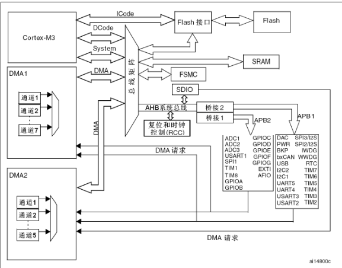


## 5、GPIO寄存器

### 5-1 4种输出模式

```
通用推挽输出模式
通用开漏输出模式
复用推挽输出模式
复用开漏输出模式
```

### 5-2 I/O端口位的基本结构

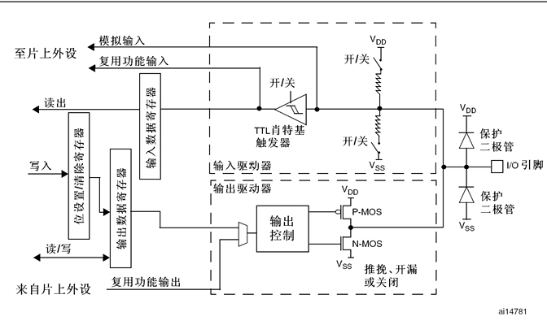

推挽（push-pull）：N/P MOS管是交替工作的，不能同时导通，推就是P MOS管导通VDD连接输出端，此时输出高电平，挽就是N MOS管导通VSS（GND）连接输出端，此时输出低电平，外部负载的电流会流向地。

开漏（open-drain）：即漏极保持断开，因为P MOS管是N MOS管的漏极，所以P MOS管会保持断开，此时我们只能控制N MOS管的导通，导通输出低电平，断开I/O引脚悬空，输出端电流趋近于0，会产生高阻抗。

通用：直接通过cpu控制引脚。

复用：通过其他片上外设控制引脚。

### 5-3 I/O最大输出速度

定义：向I/O交替写0和1且输出不失真的最快速度，即每秒能够产生的上下降沿的最大次数。

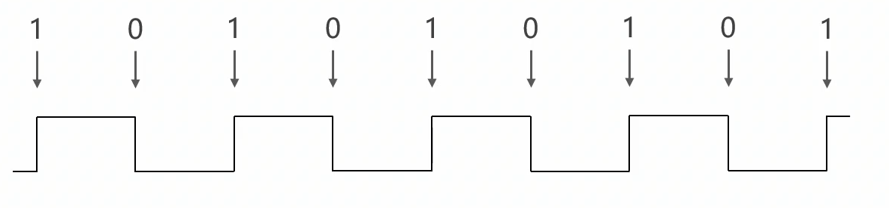

上升/下降时间：在理想状态下，电平翻转是一瞬间完成的，但实际上从低/高电平到高/低电平之间会有一段变化时间，这就是上升/下降时间。

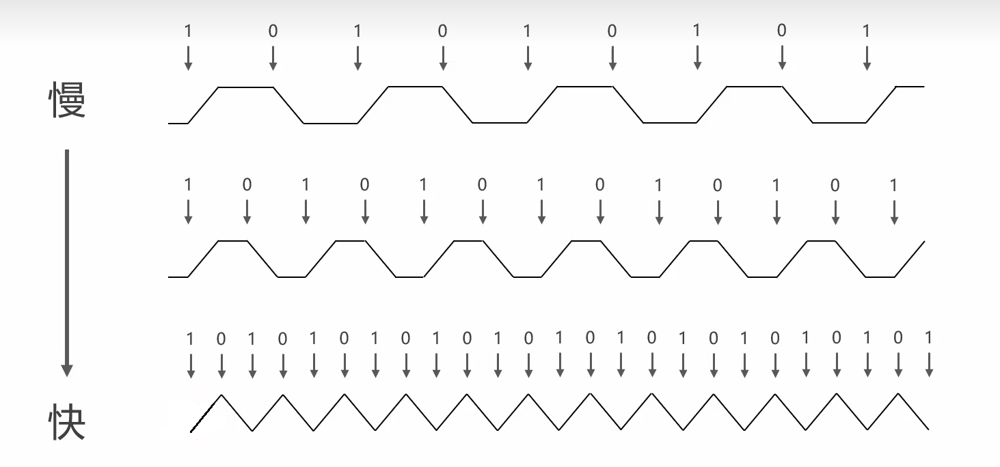

在相同的时间内，电平翻转的次数越多，电平的保持时间就越短，电平的保持时间必须大于上升/下降时间，所以IO最大输出速度收到上升/下降时间影响，上升/下降时间越短，IO的最大输出速度就越高。

最大速度选择：

```
低速：2MHz，上升/下降时间125ns
中速：10MHz，上升/下降时间25ns
高速：50MHz，上升/下降时间5ns
```

假设高低电平保持时间一致，那么在低速的情况下，通过公式`1s/2MHz`得到一个完整周期的时间为500ns，减去上升和下降时间，高低电平平均保持时间为125ns。

### 5-4 闪烁灯教学

目标：使最小系统板上的蓝色led灯隔1s交替闪烁

**第一步：查看原理图**

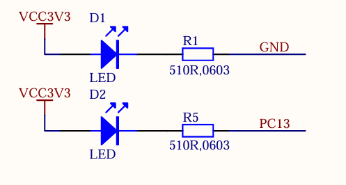

D2即我们所需的蓝色led，自身有3.3V供电，连接到PC13引脚，此时若PC13接地，电流导通，led亮起，若PC13悬空则led熄灭，由此我们最好选择开漏模式，虽然选择推挽模式也可以，在推的情况下内外3.3V电压持平，无电流经过，但如果发生短路或静电可能会导致引脚击穿。

**第二步：翻阅手册，配置GPIO端口**

开启GPIOC的时钟

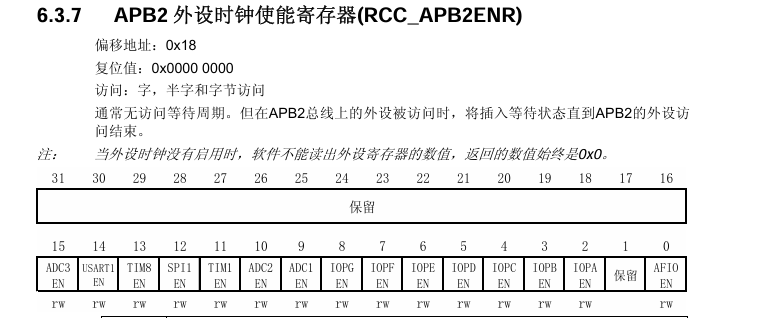

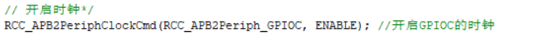

库函数内部结构就是将`RCC_APB2ENR`第4位置为1开启GPIOC的时钟。


定义的结构体变量用于配置

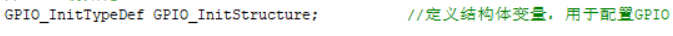

设置GPIO工作模式、选择使用引脚、设置最大输出速度

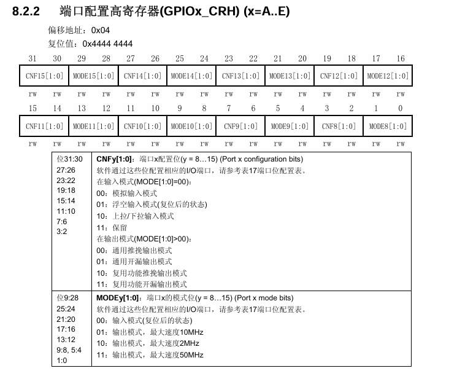

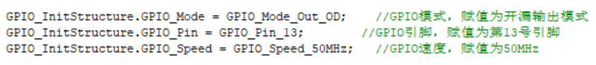

GPIOC使用配置


高配置寄存器负责pin8~pin15的管理，库函数`GPIO_Init`内部就是将`GPIOC_CRH`的CFN13设置成01，MODE13设置成11。

**第三步：编写业务逻辑**

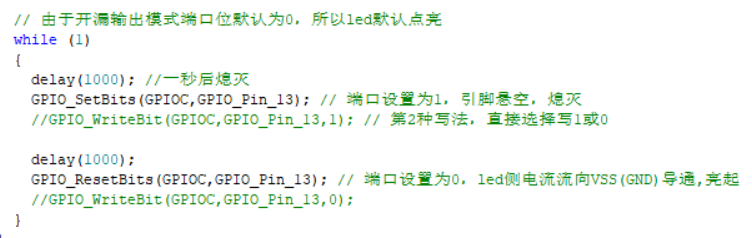

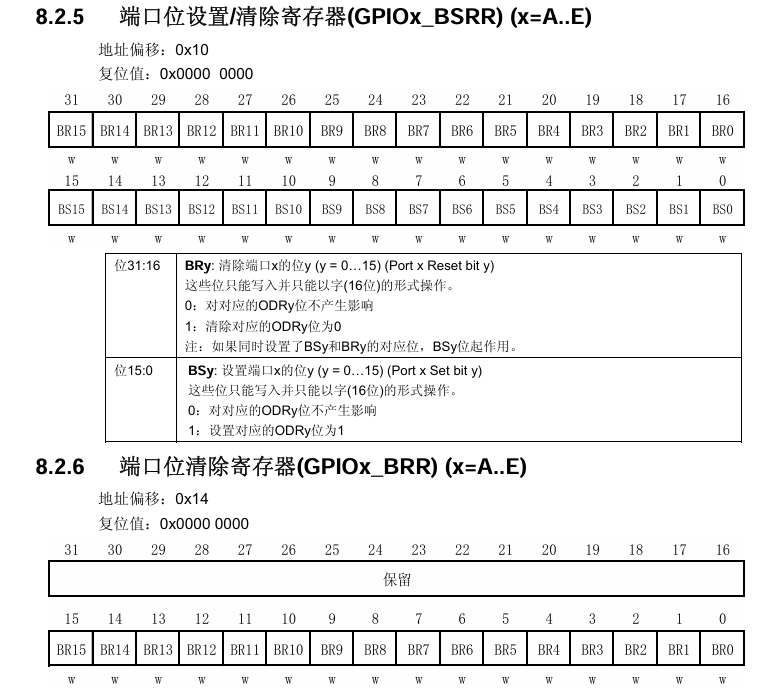

`GPIOC_BSRR`既能够置1也能够置0，`GPIOC_BRR`只能够置1以清除端口位为0，实际上`GPIO_SetBits`和`GPIO_ResetBits`库函数内部就是操作这两个寄存器，分别将13位置1来控制亮灭，此外还有个`GPIOx_ODR`只能置1以设置端口位为1，不常用，最好就使用通用的库函数`GPIO_WriteBit`封装的`GPIOC_BSRR`，既可以置0也可以置1。

delay延时函数

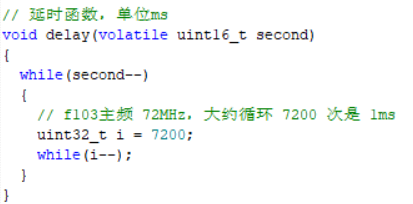

由于芯片主频为72MHz，cpu执行while循环过程短到几微秒，且如果只使用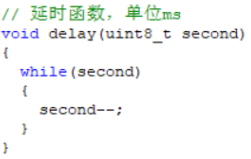 、、

循环内部没有控制任何硬件，编译器可能会将其优化掉，所以根据主频我们得出循环7200次大概为1ms，再加上`volatile`关键字防止被编译器优化。

### 5-5 4种输入模式

```
上拉输入模式
下拉输入模式
浮空输入模式
模拟输入模式
```

上拉输入：外接上拉电阻接到VCC，当没有外部输入时为高电平，不会影响外部输入。

下拉输入：外界下拉电阻到VDD，当没有外部输入时为低电平，不影响外部输入。

### 5-5 按键控制led亮灭教学

使用精灵1开发板

目标：实现一个按键按下led亮起，再次按下熄灭，循环往复。

**第一步：查看原理图**

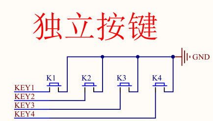

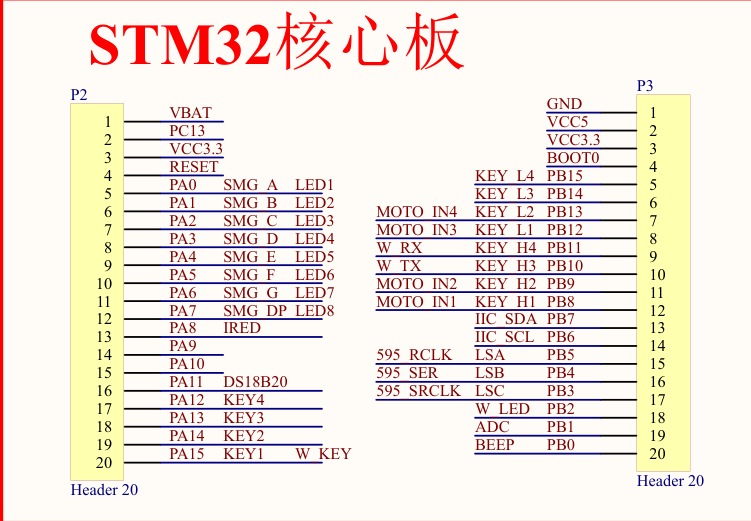

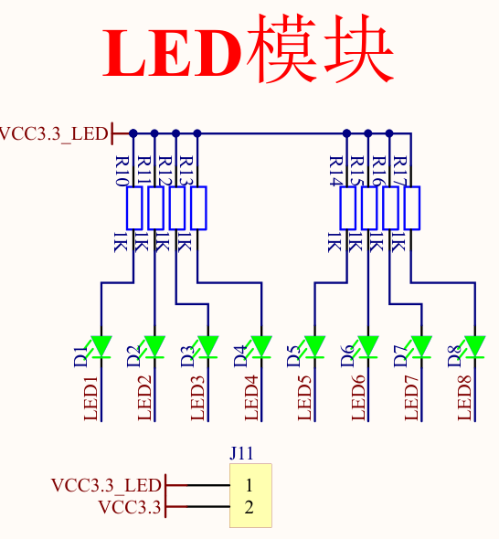

选择使用按键KEY1控制，即配置pa15 控制 pa0 led1亮灭

**第二步：翻阅手册，配置GPIO端口**

开启GPIOA的时钟


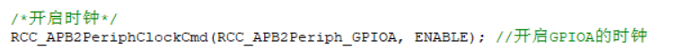

将`RCC_APB2ENR`第2位置为1开启GPIOSA的时钟。

定义按键和Led灯的配置结构体变量

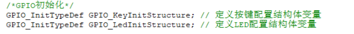

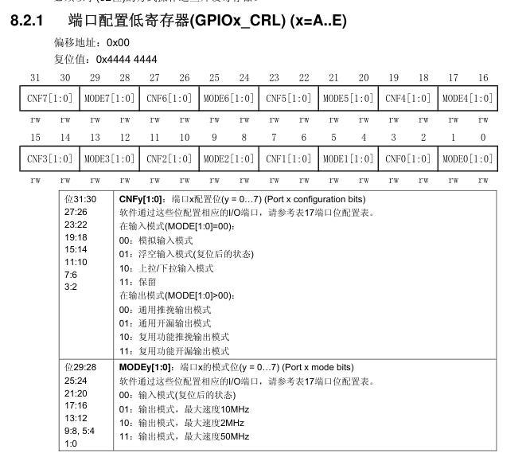


pa0属于低8位引脚，pa15属于高8位引脚，通过不同的配置寄存器进行配置。

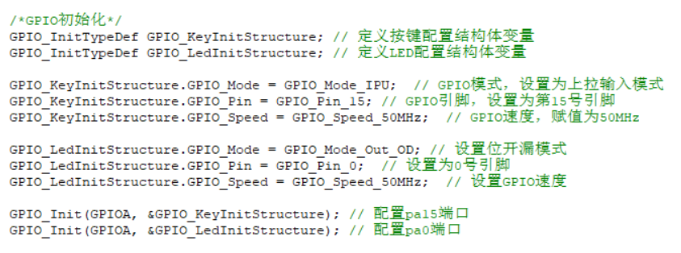

按键引脚设置为上拉输入，平时保持高电平，当按键按下产生下降沿，引脚处变为低电平

led引脚设置为开漏输出，默认置0亮起。

**第三步：编写业务代码**

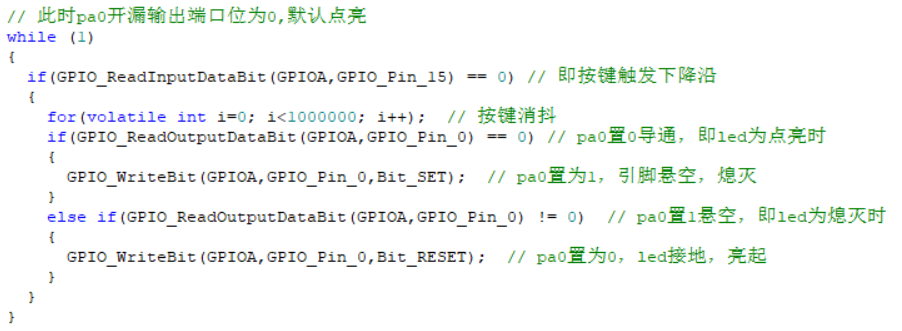

while循环一直执行，直到检测到按键按下，即pa15变为低电平，触发下降沿，再根据pa0状态，将其点亮或熄灭。

消抖：由于cpu执行while循环的速度远远大于按下再松开按键的速度，当按键处于按下状态时，立马执行完第一次循环后再次进入循环对按键状态进行判断，此时没来得及松开仍然为按下状态，于是又执行一次，结果与上一次相反，所以会导致我们明明只按下一次按钮，led灯却会亮灭好几次，解决的办法就是延长执行一次循环的时间，使循环一次的时间大于松开按键的时间。